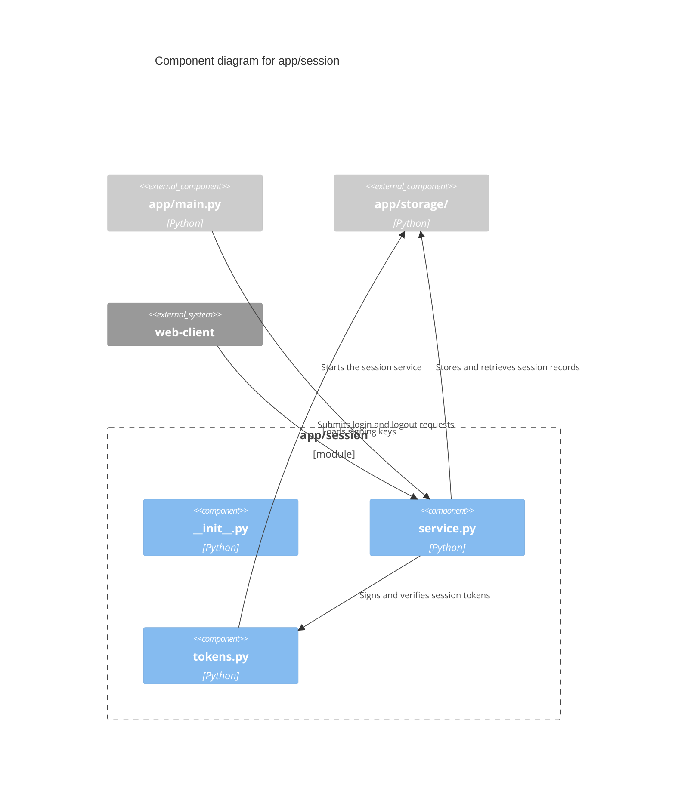
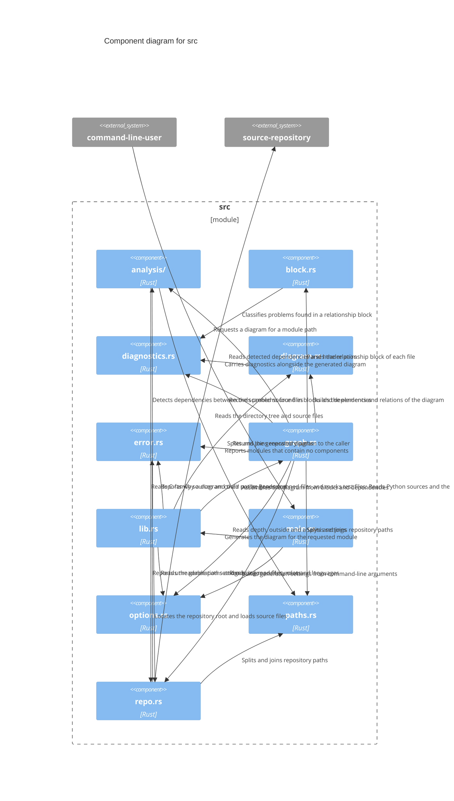

# c4gen

`c4gen` takes the path of a software module and writes a C4 component diagram of it in [Mermaid](https://mermaid.js.org/syntax/c4.html) syntax. It is a Rust library with a small command-line front end, and it has no dependencies outside the standard library.

Each source file of the module becomes a component. Each arrow, and the text on it, comes from the *Relationships block* at the top of a file:

```rust
// Relationships:
// - `src/crypto/token.rs`: Signs and verifies session tokens
// - `src/storage/repo.rs`: Stores and retrieves session records
// - `external:web-client` (inbound): Submits login and logout requests
```

The rules for writing these blocks are in `Relationship Comment Instructions.md`, one directory above this package. Rust, Python, C and C++ source files are supported.

The same source files always give the same diagram, byte for byte.

## Example

```console
$ c4gen --root tests/fixtures/python_app tests/fixtures/python_app/app/session
```



The diagram goes to standard output. Problems found on the way go to standard error:

```text
app/session/service.py:1: warning[undocumented]: the code refers to `app/storage/cache.py`, but the block has no line for it
app/session/tokens.py:2: warning[unconfirmed]: no reference to `app/storage/repo.py` was found in the code
```

## Building

```console
$ cargo build --release      # binary at target/release/c4gen
$ cargo test
```

## Command line

```text
Usage: c4gen [OPTIONS] <MODULE>

Arguments:
  <MODULE>  Directory or source file to draw

Options:
      --root <DIR>          Repository root that target paths are relative to
                            [default: nearest directory above MODULE that
                            contains .git, .hg or .svn]
      --depth <N|all>       Directory levels of the module drawn in full; deeper
                            directories become one box each [default: 1]
      --outside <MODE>      How project files outside the module are drawn:
                            collapse, files or hide [default: collapse]
      --exclude <ENTRY>     File or directory to skip, by name or by path from
                            the root; may be repeated
      --no-default-excludes Do not skip the directories that are skipped by
                            default (target, node_modules, vendor, build, ...)
      --search-path <DIR>   Directory, relative to the root, searched first for
                            C/C++ includes and Python imports; may be repeated
      --no-code-analysis    Build the diagram from Relationships blocks alone
      --title <TEXT>        Diagram title
  -o, --output <FILE>       Write the diagram to FILE instead of standard output
      --strict              Exit with status 1 if any diagnostic is reported
  -q, --quiet               Do not print diagnostics
  -h, --help                Print this help
  -V, --version             Print the version
```

The exit status is 0 on success, 1 with `--strict` when any diagnostic was reported, and 2 when no diagram could be generated. `c4gen --strict` is therefore usable as a check that every block in a module is complete and well formed.

## Library

The public interface is one function, its options, and the plain data it returns.

```rust
use c4gen::{generate, Depth, Options, Outside};

fn main() -> Result<(), c4gen::Error> {
    let options = Options::new()
        .root("/path/to/repository")
        .depth(Depth::Unlimited)
        .outside(Outside::Files);
    let diagram = generate("/path/to/repository/src/session", &options)?;

    println!("{}", diagram.to_mermaid());
    for diagnostic in &diagram.diagnostics {
        eprintln!("{diagnostic}");
    }
    Ok(())
}
```

| Item | What it is |
|---|---|
| `generate(module, &options)` | Generates the diagram of the module at a path. Returns `Result<Diagram, Error>`. |
| `Options` | The settings listed under [Command line](#command-line), as public fields with builder methods. `Options::default()` matches the command-line defaults. |
| `Depth`, `Outside` | The values of the `depth` and `outside` settings. |
| `Diagram` | The result: `title`, `module`, `elements`, `relations` and `diagnostics`, all in a fixed order. `to_mermaid()` and `Display` render it. |
| `Element`, `ElementKind` | A box or boundary: identifier, kind, path, label, technology and parent boundary. |
| `Relation`, `RelationSource` | An arrow, and the block lines or detected dependencies it stands for, each with file and line number. |
| `Diagnostic`, `DiagnosticKind`, `Severity` | A problem in a block, with file, line, kind and message. |
| `Error` | Why no diagram could be generated. |

A caller that draws diagrams itself can ignore `to_mermaid()` and read `elements` and `relations` directly. Run `cargo doc --open` for the full reference.

## How a diagram is built

### Components

Every Rust, Python, C and C++ source file under the repository root is a component, except test code and build scripts. A C or C++ implementation file is merged into the header of the same name that sits beside it, that it includes, or that includes it. The pair is one component, identified by the header.

### Arrows

1. **Every line of a Relationships block gives an arrow** with that line's label. A target that is a file path ends at that file's component. A target written `external:name` ends at an external system, and `(inbound)` reverses the arrow so that it starts there.
2. **The code is analysed as well**, and the two are compared:

   | Code refers to the file | Block has a line | Result |
   |---|---|---|
   | yes | yes | Arrow with the line's label |
   | yes | no | Arrow with no label, and an `undocumented` warning |
   | no | yes | Arrow with the line's label, and an `unconfirmed` warning |

   A line is never dropped because the analysis could not confirm it. Pass `--no-code-analysis` to build the diagram from the blocks alone.

When several relationships end up between the same two boxes, they are drawn as one arrow whose label is their distinct labels joined with `; `.

### Layout

The module is drawn as a boundary around its components.

- **Subdirectories** are collapsed into one box each by default. `--depth 2` draws one more level as nested boundaries, and `--depth all` draws every file.
- **Project files outside the module** appear only when they have a relationship with something inside it. By default each is represented by its neighbouring directory: the top-most directory that contains the file but not the module. `--outside files` draws each file separately, and `--outside hide` leaves them out.
- **External systems** appear when a component inside the module names them.
- **A Rust module root** such as `src/storage.rs`, which has its submodules in `src/storage/`, is drawn inside `src/storage`.

When the module path is a single file, the diagram shows that file and its neighbours.

## Language support

| | Rust | Python | C and C++ |
|---|---|---|---|
| Files | `.rs` | `.py` | `.c` `.h` `.cc` `.cpp` `.cxx` `.c++` `.hh` `.hpp` `.hxx` `.h++` `.ipp` `.tpp` `.inl` `.tcc` |
| Block comment marker | `//` | `#` | `//`, or inside one `/* */` comment |
| Dependencies detected from | `use` declarations, paths in code such as `storage::repo::save()`, and macro calls, resolved through each crate's module tree | `import` and `from … import` statements at any nesting level, and the dotted names the code goes on to use | `#include` directives |
| Followed to the defining file through | `pub use` re-exports, including globs, and other crates of the same repository | package `__init__.py` files, other re-exporting imports, and `from … import *` | umbrella headers, meaning headers that contain only preprocessor directives |
| Not a dependency | `mod` declarations; a `pub use` whose name the file does not use itself | an import whose name the file never uses, which is a re-export | includes made by an umbrella header |
| Left out as test or build code | `#[cfg(test)]` and `#[test]` items; files declared by `#[cfg(test)] mod name;`; `tests.rs` and `test.rs`; `build.rs` beside a `Cargo.toml` | `conftest.py`; `setup.py` | files named `*_unittest` |

In every language, files in a directory named `tests`, `test`, `benches` or `__tests__`, and files named `test_*`, `*_test` or `*_tests`, are test code and are left out.

The analysis is deliberately conservative. It reports a dependency only when a name can be followed to a file of the repository, so that no arrow is drawn for a dependency that does not exist. What it cannot see, it leaves to the blocks:

- names that arrive through a glob import (`use prelude::*`, `from x import *`) and are then used without a path;
- values whose type is never named, dependency injection, reflection and other run-time lookups;
- bare `#include <name.h>` and bare `import name`, which look the same as system headers and installed packages unless `--search-path` says where to find them.

## Diagnostics

| Code | Severity | Meaning |
|---|---|---|
| `missing-block` | warning | A source file has no Relationships block. |
| `misplaced-block` | warning | A block is in an implementation file instead of its header. Its lines are still used. |
| `malformed-line` | error | A line is neither a relationship nor `None.`. It is ignored. |
| `format` | warning | A block or line can be read but its spacing or punctuation is not exactly as specified; or the block is empty; or `None.` is combined with other lines. |
| `duplicate-target` | error | Two lines name the same target. The second is ignored. |
| `unsorted` | warning | Lines are not sorted by target. Sorting ignores letter case. |
| `invalid-target` | warning | A target is not a root-relative path or a well-formed external name, uses `(inbound)` on a file, or names the file's own component or an implementation file. |
| `target-not-found` | error | A target names a file that does not exist. The line is ignored. |
| `target-not-component` | error | A target names test code, a build script, or a hidden or excluded file. The line is ignored. |
| `label` | warning | A label has fewer than two or more than eight words, contains a character other than letters, digits, spaces, hyphens and commas, does not start with a capital, or starts with a verb such as `Uses` or `Calls`. |
| `undocumented` | warning | The code refers to a file that the block has no line for. |
| `unconfirmed` | warning | A line names a file that the code does not appear to refer to. Checked only between files of the same language. |

Errors mean something written in a block could not be used. Only diagnostics that concern the module being drawn are reported.

Where the tool is more lenient than the commenting instructions:

- In C and C++, `#pragma once` or an `#ifndef`/`#define` include guard may come before the block.
- An external system may have one outbound line and one `(inbound)` line in the same block.
- A target may name an existing file in a language the tool does not read. It is drawn as a component with no technology.

## Determinism

The output is a pure function of the files under the repository root and the options.

- Directories are read in sorted order, and every collection that affects the output is ordered.
- Nothing depends on the clock, the environment, the absolute location of the repository or the platform's path separator.
- Element identifiers are derived from paths, and identifiers that would collide are numbered in path order.
- Symbolic links are not followed, and file names that are not valid UTF-8 are skipped.

`tests/golden` holds the expected output for the fixture projects in `tests/fixtures`, and the tests compare against it byte for byte.

## This package

The package follows its own convention: every file in `src` has a Relationships block, and a test fails if `c4gen --strict src` reports anything or if the diagram below is out of date.



## Development

```console
$ cargo test                         # unit tests, golden tests, doc tests
$ C4GEN_BLESS=1 cargo test           # rewrite tests/golden and the diagram above after an intended change
$ cargo run -- --root . --strict src
```

Mermaid marks its C4 support as experimental. It lays the boxes out on a grid and does not route arrows around them, so labels can overlap in larger diagrams.
